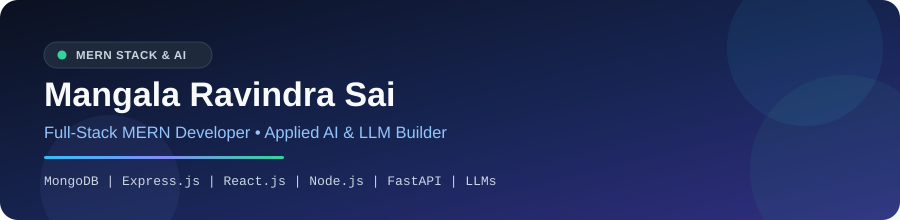

  

  
  
  

---

### 👋 Hey there! I'm Ravindra Sai

I'm a **MERN Stack Developer** who loves building fast, clean full-stack web applications and practical **AI / LLM** tools.

- ⚡ I focus on **MongoDB, Express.js, React.js, and Node.js** for responsive UIs and scalable REST APIs
- 🔐 Experienced in building **secure auth systems** (JWT with RSA signing, Google & Microsoft OAuth SSO) and **multi-tenant architectures**
- 🤖 Exploring **Applied AI** — structured LLM pipelines, RAG workflows, and vector search with **FastAPI, Groq, LangChain, and FAISS**
- 🚀 Always optimizing for speed, clean architecture, and great developer & user experience

---

### 🛠️ Tech Stack

**MERN Stack (Core)**

  
  
  
  

**Frontend, Backend & Databases**

  
  
  
  
  
  
  
  

**AI / LLM & Developer Tools**

  
  
  
  
  
  
  
  

---

### 🚀 Featured Projects

| Project | What It Does | Stack |
| --- | --- | --- |
| [**AI Career Assistant**](https://github.com/ravindracode/ai-career-assistant) | Full-stack PDF resume analyzer with Groq structured JSON extraction, Pydantic validation, MongoDB persistence & React dashboard | `React` `FastAPI` `MongoDB` `Groq` `Pydantic` |
| **Document Q&A Tool (RAG)** | Retrieval-Augmented Generation pipeline indexing `.txt` chunks with HuggingFace embeddings + FAISS for grounded Q&A | `Python` `LangChain` `FAISS` `OpenAI` |
| **PDF Conversational Chatbot** | Extracts text from uploaded PDFs and powers natural-language follow-up conversations grounded in document content | `Python` `OpenAI API` `PDF Parser` |

---

### 💡 What I Enjoy Building

- **Full-Stack MERN Apps:** Clean component architecture, RESTful backends, and smooth database modeling
- **High-Performance APIs:** Profiling slow endpoints and optimizing queries & payloads for sub-100ms responses
- **Applied AI Workflows:** Turning messy documents into reliable, structured software outputs

---

  Always open to connecting with fellow developers and teams • <a href="https://linkedin.com/in/RavindraSai">LinkedIn</a> • <a href="mailto:ravindrasai44211@gmail.com">ravindrasai44211@gmail.com</a>

